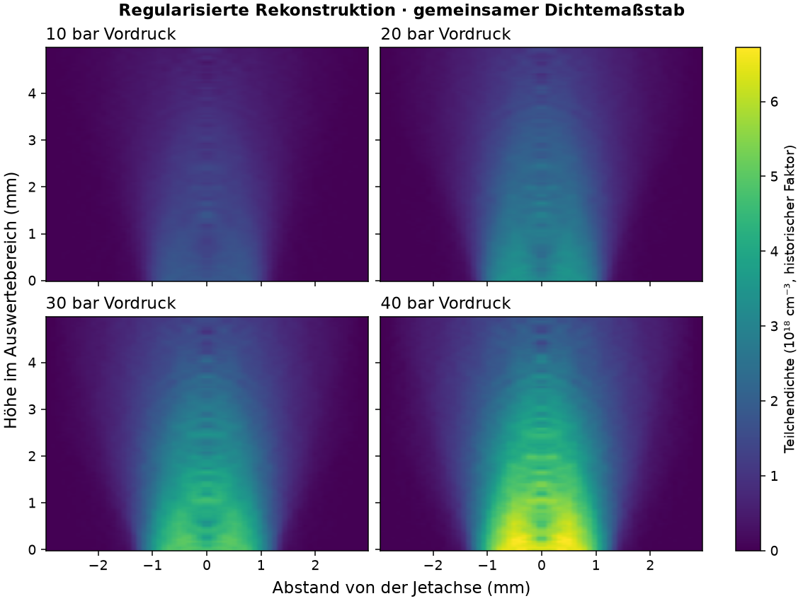
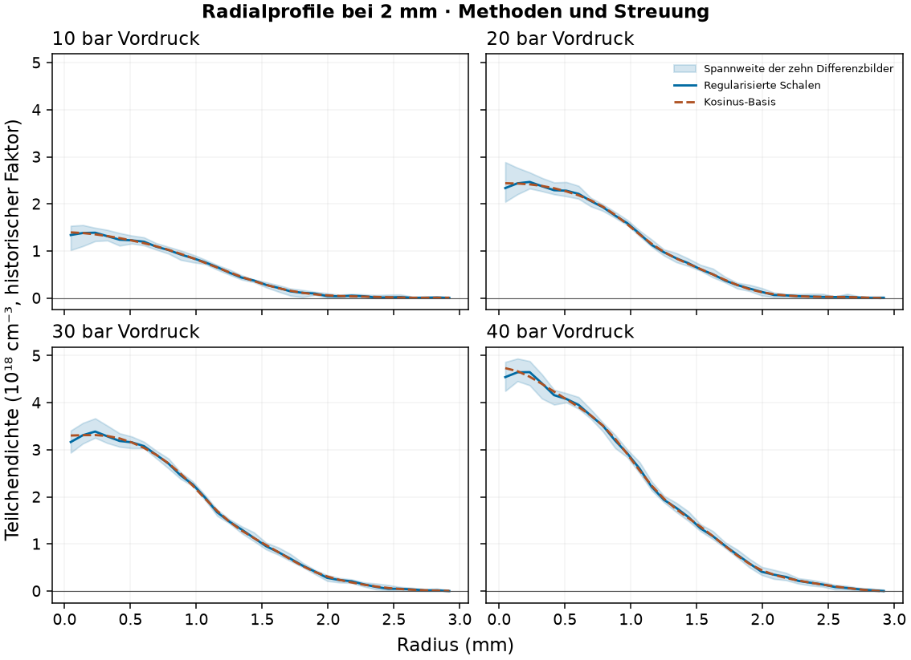
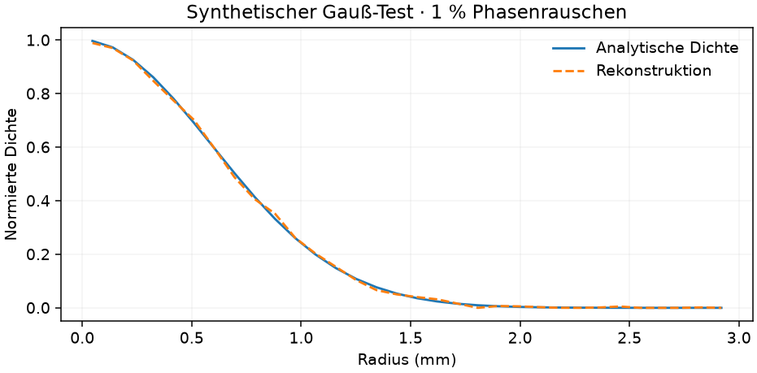

# Gasjet-Charakterisierung

Fortgeschrittenenpraktikum Physik an der Heinrich-Heine-Universität Düsseldorf. Aus den Phasenbildern eines SID4-Wellenfrontsensors werden radiale Dichteprofile des Gasjets rekonstruiert. Die gezeigten Dichtekarten, Profilvergleiche und der synthetische Referenztest werden mit dem Auswertungscode dieses Repositories erzeugt.

Versuch und ursprüngliche Auswertung: Jonas Weingart und Levin Gleinert (laut Versuchsbericht).

[Auswertung](#auswertung) · [Reproduktion](#reproduktion)

## Auswertung

Die Neuauswertung verwendet die **40 vorhandenen Differenzbilder** der vier Druckstufen mit je zehn Bildern. Sie setzt bei der bereits gebildeten Phasendifferenz an. Zusätzlich werden drei ursprüngliche SID4-Phasenexporte bei 10 bar für einen gezielten Referenzvergleich gelesen. Die Zuordnung aller 40 Differenzbilder zu den jeweils eingesetzten Gas- und Referenzframes ist nicht vollständig belegt.



### Was die Daten zeigen

Bei einer Höhe von 2 mm über der Unterkante des Auswertebereichs steigt die modellabhängige Peakdichte über die vier Druckstufen. Der äußere Halbwertsdurchmesser bleibt an dieser Höhe in einem engen Bereich.

| Vordruck | Peakdichte bei 2 mm (10¹⁸ cm⁻³) | Äußerer Halbwertsdurchmesser (mm) |
| ---: | ---: | ---: |
| 10 bar | 1,39 | 2,25 |
| 20 bar | 2,47 | 2,24 |
| 30 bar | 3,39 | 2,30 |
| 40 bar | 4,65 | 2,26 |



Die Schalenrekonstruktion und die Kosinus-Basis zeigen bei 2 mm einen ähnlichen Profilverlauf. Beide werden auf dieselben vorverarbeiteten Phasen angewendet. Die schattierte Fläche umfasst die Minima und Maxima der zehn Einzelrekonstruktionen. Sie beschreibt beobachtete Streuung. Geteilte Referenzbilder können die Rekonstruktionen korrelieren.

- **Rückprojektion.** Bei den regularisierten Schalen beträgt der relative L²-Fehler gegen die vorverarbeitete mittlere Phase etwa 2,0–2,9 %. Bei der Kosinus-Basis sind es 2,1–3,1 %. Die Schalen haben mehr Freiheitsgrade. Der Anpassungsfehler allein entscheidet daher nicht über die Qualität der Inversion.
- **Rotationssymmetrie.** Separate Rekonstruktionen der linken und rechten Hälfte unterscheiden sich im relativen Profilvergleich um etwa 7–12 %. Das begrenzt die Aussagekraft kleiner radialer Strukturen und des Zentralprofils.
- **Referenzwahl.** Für die untersuchte Einzelaufnahme bei 10 bar unterscheiden sich die mit Vorher- und Nachher-Referenz erhaltenen Phasensignale relativ zur Norm ihres Mittels um 9,6 %. Dieser Vergleich belegt die Empfindlichkeit dieses Falls.
- **Numerische Kontrolle.** Im synthetischen Gauß-Test mit 1 % Rauschen relativ zur Spitzenphase beträgt der Rekonstruktionsfehler 1,6 %. Der Test prüft ein Profil mit bekannter Lösung.



[Profile und Sensitivitäten bei fünf Höhen](results/analyse/profile.csv) · [Rückprojektion und Symmetrie](results/analyse/diagnostik.csv) · [Referenzvergleich](results/analyse/referenzwahl.csv)

### Methodik und Grenzen

1. **Phasenmaßstab und Ausschnitt.** Das Phasenraster verwendet 5 mm / 118 px. Der ältere Kameramaßstab von rund 0,01064 mm/px gilt für das Kameraraster. Der historische Auswertebereich von 118 × 151 Phasenpixeln bleibt beibehalten. Die Höhenskala folgt den Pixelabständen, mit Null an der Unterkante des Ausschnitts. Die absolute Düsenposition ist damit nicht bestimmt.
2. **Hintergrund und Achse.** Eine lineare Basislinie wird aus den äußeren 15 Spalten auf jeder Seite geschätzt. Die Sensorphase wird entsprechend der dokumentierten Vorzeichenkonvention in Radiant umgerechnet. Eine gemeinsame Subpixelachse minimiert Unterschiede zwischen gespiegelten Profilen. Die Vorwärtsrechnung arbeitet auf verschobenen Koordinaten, ohne Pixel am Rand zyklisch umzuwickeln.
3. **Inverse Rekonstruktion.** Die Vorwärtsmatrix integriert die Sehnen konzentrischer Schalen. Die Auswertung vergleicht eine Kosinus-Basis bis Ordnung 10 mit 32 nichtnegativen Schalen und einer quadratischen Strafe auf zweite radiale Differenzen. Die Tabelle enthält eine Variation der Achse um ±1 Phasenpixel und eine Halbierung bzw. Verdopplung der Regularisierungsstärke. Die Ergebnismaße sind für den gewählten Ausschnitt und die angenommene Rotationssymmetrie gültig.
4. **Dichteskala.** Für die Umrechnung werden die dokumentierte Wellenlänge von 635 nm und der historische Polarisierbarkeitsfaktor verwendet. Der Faktor wurde hier nicht unabhängig kalibriert. Die absoluten Dichtewerte sind daher bedingt durch diese Annahme. Die Peakdichte beschreibt das Maximum des Schalenprofils. Der Halbwertsdurchmesser verwendet den äußeren Halbwertsschnitt, auch bei einem Maximum abseits der Achse.

Die methodische Einordnung stützt sich auf den [Vergleich numerischer Abel-Transformationen von Hickstein et al.](https://doi.org/10.1063/1.5092635) und die [Arbeit zur Tikhonov-Regularisierung von Daun et al.](https://doi.org/10.1364/AO.45.004638).

## Reproduktion

Python 3.12 mit den Versionen aus [requirements.txt](requirements.txt). Tests und synthetische Referenzrechnung laufen mit einem öffentlichen Checkout.

```sh
python -m pip install -r requirements.txt
python -m pytest -q
python gasjet_plots.py --output-dir .local/demo
```

Mit lokalem Zugriff auf den Originalbestand:

```sh
python gasjet_plots.py --data-root /pfad/zur/versuchsablage --output-dir .local/auswertung
```

Die Auswertung liest die zehn kommagetrennten Differenzmatrizen pro Druck aus `Abbildungen/<Druck>bar` sowie die drei dokumentierten SID4-Exporte aus `Processed_data/10barGasDruck/Results`. Die veröffentlichten Dateien sind Code, Tests, neu erzeugte Abbildungen und kompakte Ergebnistabellen. Messdaten und Arbeitsläufe gehören in das lokale Quellarchiv beziehungsweise in `.local/`.

[gasjet.py](gasjet.py) enthält Vorwärtsmodell, Rekonstruktion und Referenztest. [gasjet_plots.py](gasjet_plots.py) erzeugt Tabellen und neue Abbildungen.
